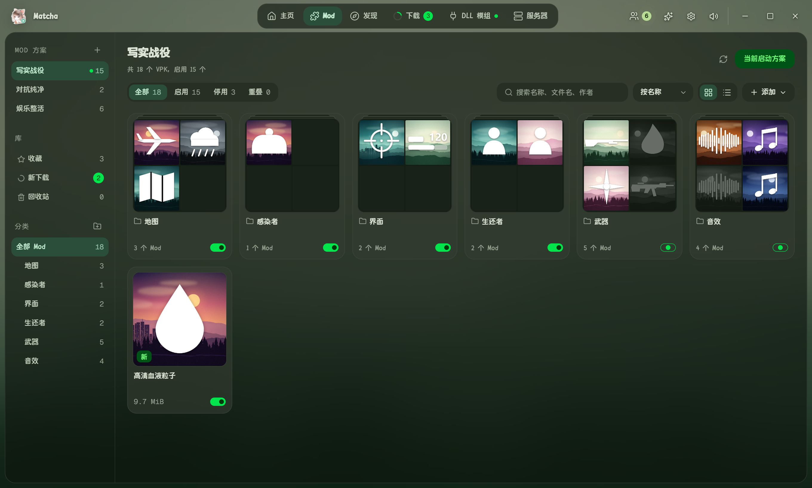

<p align="center">
  
</p>

<p align="center"><strong>给战役和对抗各留一套 Mod。今晚玩哪种，就选哪套开局。</strong></p>
<p align="center">
  <a href="https://github.com/RagDollOvO/Matcha-Launcher/releases/latest"><strong>↓ 下载 Windows x64 正式包</strong></a>
  &nbsp; · &nbsp; <a href="docs/platform/MATCHA_DESKTOP_UPDATE.md">1.0.3 更新说明</a>
  &nbsp; · &nbsp; <a href="docs/platform/MATCHA_DESKTOP.md">使用手册</a>
</p>

## 一份 Mod 库，多种玩法

Matcha 把本地 VPK、创意工坊和 GameMaps 下载的内容放到同一个界面。比如你想在战役里用一套音效，又想给周末联机留一套地图：文件各存一份，把需要的项目勾进对应方案。下次开局前，只要在主页选好方案。



*图中为演示库：「写实战役」启用了 18 个 VPK 中的 15 个。* [查看启动器主页预览](docs/showcase/home.png)

- **导入与找回。** 把 VPK 或素材文件夹拖进 Mod 页。遇到同名包，Matcha 会列出目标，确认后先备份再替换。误删的 Mod 可凭封面在回收站找回，原分类和方案选择也会恢复。
- **发现与下载。** 搜工坊、逛 GameMaps，选好地图或 Mod 就能加入下载队列。浏览器下载的 ZIP 可以展开选取里面的 VPK。[Mod 使用说明](docs/platform/MODS.md)
- **找朋友开一局。** 登录 Steam，点右上角好友图标查看谁在玩；展开可加入的服务器，看看地图、人数和延迟。常去的服务器可以收藏到主页。[服务器与好友](docs/platform/SERVERS.md)
- **让茶茶帮忙整理。** 例如问「这两个 Mod 改了哪些相同的资源？」。在设置里配置自己的模型服务后即可使用；通用文件与终端操作会先展示路径或命令，读取结果会随对话发送给所选服务商。[茶茶接入说明](docs/platform/PI_CLI.md)

## 第一次开局

1. 下载上面的 **Windows x64 正式包**，完整解压到一个文件夹，再双击 **Matcha.exe**。运行环境为 Windows x64 和 Microsoft Edge WebView2。
2. 确认 Matcha 识别到的《求生之路 2》安装目录。游戏退出时，把第一个 VPK 拖进 **Mod** 页，确认后它会在当前启动方案里点亮。
3. 回到 **主页**，选好方案和启动方式，再点 **启动游戏**。要应用这套 VPK 方案，选 **L4N 平台**；要按 Steam 原版目录启动，选 **纯净对抗**。

**从旧版升级：** 右键系统托盘里的 Matcha，选「退出」，再打开新解压的版本。本机设置和方案会沿用。平时点窗口的 × 会将 Matcha 收到托盘。

## 从源码开始

界面使用 [Svelte 5 与 TypeScript](src/)，Windows 桌面壳使用 [Tauri 2 与 Rust](src-tauri/)。VPK 扫描、方案保存、下载和服务器查询都在[本机 Node.js 服务](backend/)里。

在 Windows 上准备 Node.js 24.x 和 npm，于仓库根目录运行：

```powershell
npm ci
npm ci --prefix backend
npm run dev
```

以上命令启动浏览器开发界面。准备桌面发布文件夹时，见[便携包预检与构建](docs/platform/PACKAGING.md)；要修改服务器、Mod 或启动流程，从[代码维护入口](docs/frontend-architecture.md#按功能找代码)开始。

[反馈问题](https://github.com/RagDollOvO/Matcha-Launcher/issues) · [第三方许可](docs/licenses/) · [提示音来源](public/sfx/SOURCES.md) · [DSH Browser 来源](src/lib/browser/dsh/SOURCE.md)
