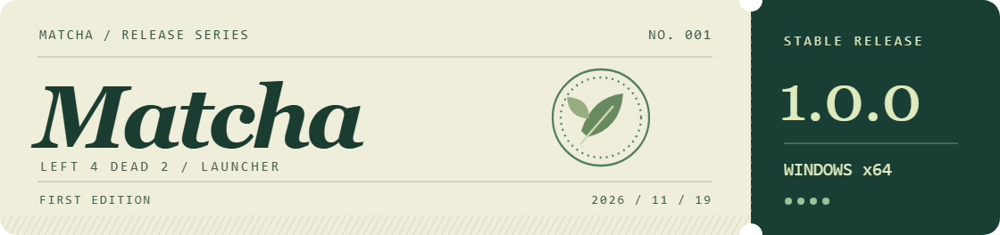
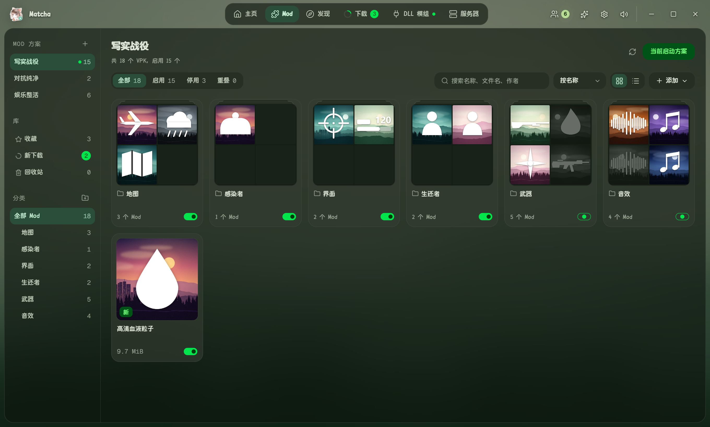

**[↓ 下载 Matcha 1.0.0 · Windows x64](https://github.com/RagDollOvO/Matcha-Launcher/releases/download/v1.0.0/Matcha-1.0.0-Windows-x64.zip)**　·　免安装 ZIP，约 260 MiB　·　[查看源码](https://github.com/RagDollOvO/Matcha-Launcher/tree/v1.0.0)

完整解压后双击 `Matcha.exe`，确认《求生之路 2》的安装目录，就可以准备第一局了。从旧版升级，请先右键托盘里的 Matcha 选择「退出」；新版会沿用你的设置和方案。

---

### 开局之前，在 Matcha 里做三件事

**01　把喜欢的 Mod 拖进来**  
VPK 直接导入，素材文件夹可以打包。遇到同名包，会先列出文件名，等你确认后再备份、替换。手动导入会点亮当前启动方案的开关，工坊更新则保留原开关。

**02　给今晚选一套方案**  
给战役留一套音效，给朋友间的整活局留一套地图。开局前切换方案，就能用同一份 Mod 库搭配不同玩法。误删的 Mod 可以在回收站凭封面找回来。

**03　看看队友在哪张图**  
登录 Steam 后，点右上角的好友图标。遇到可加入的服务器，展开就能看到地图、人数和延迟，再决定要不要加入。

<strong>看看 Mod 管理界面</strong> · 分类、封面和启动方案

[Mod 使用手册](https://github.com/RagDollOvO/Matcha-Launcher/blob/v1.0.0/docs/platform/MODS.md) · [服务器与好友](https://github.com/RagDollOvO/Matcha-Launcher/blob/v1.0.0/docs/platform/SERVERS.md) · [反馈问题](https://github.com/RagDollOvO/Matcha-Launcher/issues)
